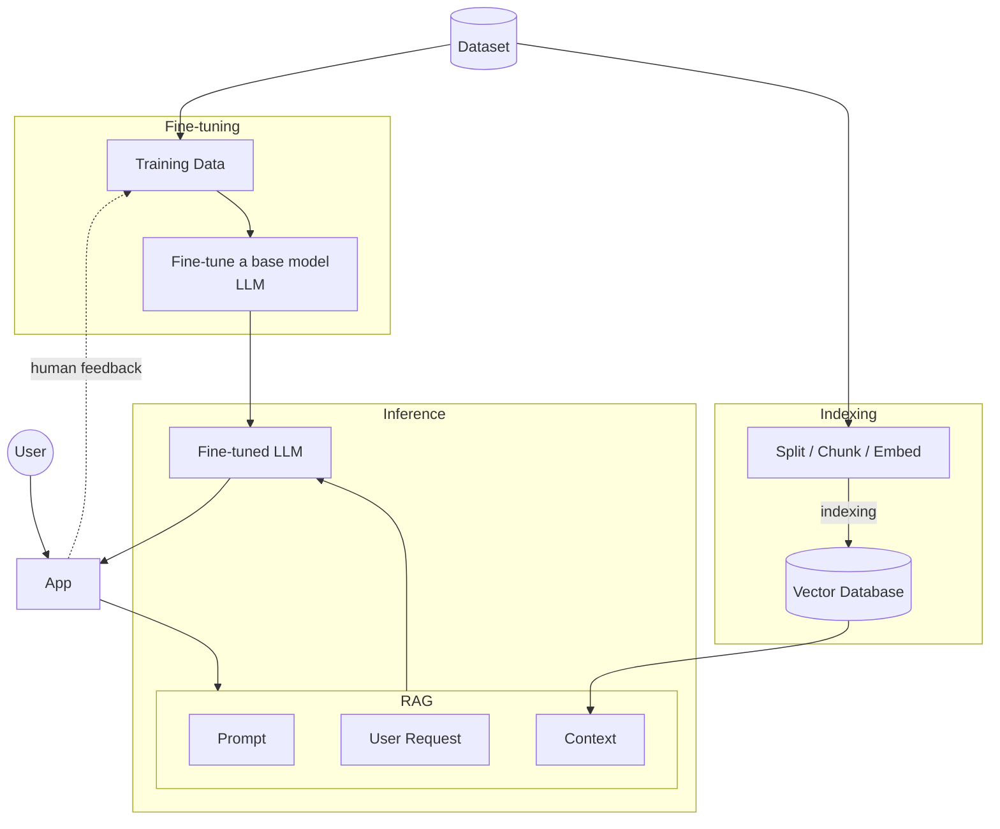

# Project Requirements

> LLM/SLM-based agentic application with RAG, fine-tuning, and an MCP tool server.

---

## Functional Requirements

The solution should:

- [ ] Support **data ingestion** of new datasets
- [ ] Allow **task-specific fine-tuning** (Q&A, etc.)
- [ ] Implement **RAG** (Retrieval-Augmented Generation)
- [ ] Develop an **MCP server** for your tools
- [ ] Include **evaluation**
- [ ] Handle **toxicity and hallucinations**

---

## 4. Model Choice & Maximum Grade

A fine-tuned SLM will be used ideally, unless we decide we don't have time for it further down the line.

---

## 5. Reference Architecture (from Powerpoint presentation)

**How it works:**

1. **Dataset** feeds two pipelines:
   - **Indexing pipeline:** documents are split, chunked, and embedded, then indexed into a **vector database**.
   - **Fine-tuning pipeline:** the dataset is turned into **training data** used to fine-tune a **base model**.
2. The **user** interacts with the **app**.
3. The app builds a **RAG** input made of the **prompt**, the **user request**, and **context** retrieved from the vector database.
4. The RAG input is sent to the **fine-tuned LLM**, whose response is returned to the app.
5. **Human feedback** collected in the app flows back into the training data for further fine-tuning.

---

## 6. Evaluation Criteria

| Criterion | Description |
|---|---|
| **Completeness** | Includes data embedding, fine-tuning (if needed), and RAG techniques |
| **Originality** | Innovative approaches to problem-solving |
| **Technical Depth** | Architectural and implementation choices |

---

## 7. Deliverables & Timeline

### Week 2 — Team Formation
- [x] Team finalized

### Week 4 — RFC Submission
- [x] 1-page document containing:
  - [x] Overview
  - [x] Motivation
  - [x] Goals

### Weeks 5–6 — Architecture Presentation *(labs)*
- [ ] Dataset selection
- [ ] Chunking strategy
- [ ] Vector database choice
- [ ] Model choices
- [ ] RAG strategies to try
- [ ] Timeline proposal covering weeks 5–6 up to weeks 11–12

### Weeks 8–9 — Progress Check *(labs)*
- [ ] Presentation of updates based on the proposed timeline

### Week 14 — Final Project Presentation
- [ ] 15-minute demo
- [ ] Documentation
- [ ] Source code

> ⚠️ **Late penalty:** each delay results in a **penalty of 2 points**.
