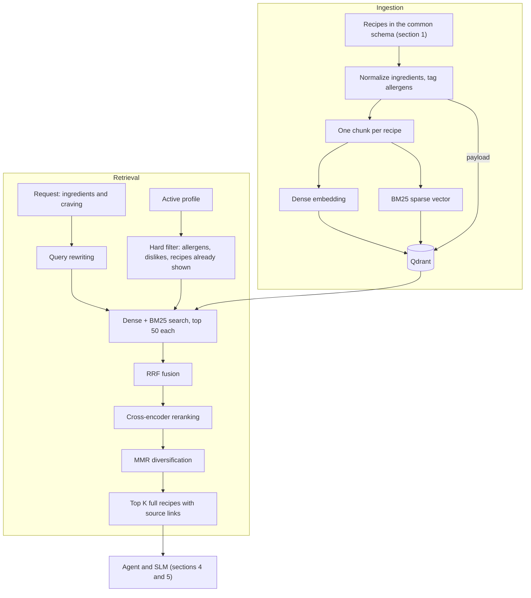

# Nibble – Milestone 2: Architecture and Plan

| Team member             | Sections                          |
| ----------------------- | --------------------------------- |
| Roșu Ioan-Luca          | 0. Overview, 4. Agent and tools, 7. Plan |
| Chelariu Răzvan-Dumitru | 1. Problem and data               |
| Crețu Vlad-Cristian     | 2. Golden dataset                 |
| Fazacaș Mihai-Tudor     | 3. RAG design                     |
| Ciocîia Marius Andrei   | 5. Model choices, 6. Safety       |

<!-- RULES: edit ONLY between your own BEGIN/END markers. Do not reformat the rest of the file. One PR per person, targeting main. -->

## 0. Architecture overview
<!-- BEGIN 0 (Luca) -->

_TODO: system diagram (Mermaid) and a short walkthrough of one request, from profile to recipe card._

<!-- END 0 -->

## 1. Problem and data
<!-- BEGIN 1 (Răzvan) -->
<!-- What task does the system handle? Which datasets (RecipeNLG, web recipes, USDA, Open Food Facts) and why? How are NEW datasets ingested (common recipe schema, accepted formats, pipeline steps)? -->

**Task.** Nibble generates a complete, structured recipe (title, servings, ingredient lines with amounts, steps) from the ingredients the user has plus a preference ("mood") such as high-protein, keto, vegan or spicy. The data work below produces (a) a recipe pool with nutrition information, (b) fine-tuning data for the SLM and (c) the golden test set (section 2).

**Datasets used and why**

| Dataset | Size | What it gives us | Why |
|---|---|---|---|
| Kaggle `recipes-dataset-64k-dishes` | 62,126 raw rows | title, category, ingredient lines, step lists | Large recipe text source. No nutrition and no servings. |
| Hugging Face `xiaoxl/recipe_data` (labelled MIT) | 107,064 rows; 24,367 have servings and calories/protein/carbs/fat | recipes with per-serving nutrition | The only source we found with full recipe text and per-serving macros. Rows with nutrition link to allrecipes.com. |
| USDA FoodData Central, SR Legacy (public domain) | 7,793 foods | per-100 g macros and household-measure gram weights | Lets us compute macros from any ingredient list and check the labels. |

Looked at and not used: RecipeNLG (about 2.2M recipes, but no nutrition and a non-commercial research licence) and MM-Food-100K (food photos with no steps, quantity-less ingredient lists, macros estimated from photos, non-commercial licence). Open Food Facts, FlavorDB and food2vec from the RFC are not used in the dataset work so far.

**How a new dataset is ingested.** Every source is converted to one common schema and goes through the same steps. The steps are scripts in `scripts/` and cells in `recipes.ipynb`. A new source needs a small adapter that maps its columns to the schema (CSV, JSON and Parquet have been read so far); there is no generic upload tool yet.

Common schema: `recipe_title`, `category`, `subcategory`, `description`, `ingredients` (list of lines with amounts), `directions` (list of steps), optional `servings` and per-serving `kcal`, `protein_g`, `carb_g`, `fat_g`, `fiber_g`, `sodium_mg`. The pipeline adds `recipe_id`, `source`, `nutrition_basis` and `single_step`.

1. **Acquire.** Kaggle through `kagglehub`; Hugging Face Parquet shards downloaded one at a time, text and nutrition columns kept, shard deleted (`scripts/pull_xiaoxl.py`); USDA SR Legacy as a CSV zip.
2. **Parse** ingredient and direction text into lists.
3. **Clean.** Drop recipes with fewer than 4 ingredients (many are truncated lists such as only `cooking spray`), under 60 characters of directions, or non-food categories (pet food, DIY). Single-step recipes are flagged, not dropped. Later (step 5) recipes with more than 4,000 kcal in total are also dropped, because big-batch recipes do not suit a home-cooking app.
4. **Deduplicate.** Key = normalized title + sorted normalized ingredients. About 60% of Kaggle rows were the same recipe listed under several categories, so one row is kept (most specific category) and all categories are stored. A new source is also checked against the existing pool (title, directions or ingredient match) so no recipe enters twice.
5. **Nutrition check.** Macros are recomputed from the ingredient lines with USDA data (`recipe_eval/nutrition.py`: hand-written overrides, then cached ingredient-to-USDA matches, then word overlap). A source label is kept only if the recomputed values agree: calories within 25%, other macros within 40%, at least 80% of ingredients matched. Recipes without servings keep computed whole-recipe totals (so calorie shares). Recipes with a total above 4,000 kcal are dropped (4,859 recipes), and for the Kaggle recipes that remain, `servings` is set to `round(total / 750 kcal)` (1 to 5) so a serving is about 750 kcal, flagged `servings_estimated`. This is a normalising choice, not a recovered fact.
6. **Merge and label.** One file, `data/recipes_merged.jsonl`. Tags are derived by rule (section 2). Training and test files are built from it (`scripts/build_train.py`, `scripts/build_examples.py`).

**Resulting pool** (`data/recipes_merged.jsonl`, 23,395 recipes)

| Source | Nutrition | Recipes |
|---|---|---|
| Kaggle | computed from ingredients, whole-recipe totals; servings estimated at about 750 kcal each | 15,251 |
| Kaggle | none (under 80% of ingredients matched), no servings | 4,798 |
| xiaoxl | per-serving label, agrees with the USDA recomputation | 3,346 |

A record has the common schema plus `calc_kcal_total`, `calc_protein_total`, `calc_carb_total`, `calc_fat_total` and `calc_coverage` (computed totals and the share of ingredients matched) and `servings_estimated`. No recipe in the pool is above 4,000 kcal in total. Computed macros are about 15% off at the median against labels, so they are estimates, not ground truth.

**How the data is used.** The pool feeds (1) the golden test set (section 2), (2) fine-tuning data for the SLM (section 5): 19,692 training and 1,036 validation examples, built from recipes that are not in the test set, and (3) the nutrition calculator, which is also used by the scorer and could be reused by the agent's nutrition tool (section 4). Check the licences before training or releasing a model: the recipe text comes from recipe sites.

<!-- END 1 -->

## 2. Golden dataset
<!-- BEGIN 2 (Vlad) -->
<!-- How are representative test cases and expected answers created? Size, format, categories (normal, edge, adversarial), how expected answers are checked (constraints, not exact text), who reviews them. Which metrics run on it? -->

**Purpose.** A test set for the recipe generator: given ingredients and a mood, does the model return a usable recipe that stays inside the ingredients and fits the mood? Expected answers are constraints, not exact text.

**How test cases are created** (`scripts/build_examples.py`). Each case is built from one recipe in the pool:
- **Request:** the recipe's ingredient names (staples removed) plus 0-2 random *distractor* ingredients taken from other recipes, shuffled, plus 1-2 mood tags the recipe really has.
- **Reference answer:** the source recipe (title, servings, ingredients, steps) and its nutrition: per serving for xiaoxl rows, whole-recipe computed totals (with servings estimated at about 750 kcal each) for Kaggle rows.
- **Tags** are derived by rule (`recipe_eval/labels.py`, thresholds in one place). Macro tags use shares of calories: `high_protein` (protein at least 25%), `high_carb` (carbs at least 55%), `low_carb` (carbs at most 20%), `keto` (carbs at most 10% and fat at least 60%). Computed shares must clear a threshold by 3 points. `low_calorie` (at most 400 kcal per serving) needs real servings, so it exists only for xiaoxl rows. Keyword tags are read from the ingredient list: `vegetarian`, `vegan`, `dairy_free`, `gluten_free`, `spicy` (approximate).

**Size and format.** 1,200 cases, 120 per tag, JSON Lines in `data/eval_examples.jsonl`. Fields: `example_id`, `recipe_id` (link to the pool), `source`, `nutrition_basis`, `request` (`ingredients`, `tags`), `distractors`, `golden`. 768 cases come from Kaggle recipes and 432 from xiaoxl; 753 request two tags; 818 contain distractors.

**Categories**

| Category | What is in the set |
|---|---|
| Normal | Ingredients of a real recipe plus 1-2 matching mood tags (all 1,200 cases) |
| Edge | Distractor ingredients the model should not be forced to use (818); single-step recipes (flagged in the pool); cases whose nutrition is computed rather than labelled (768 cases) |
| Adversarial | **Not built yet.** Planned: allergen conflicts, inedible or unsafe ingredient combinations, contradictory moods, requests that cannot be satisfied from the given ingredients |

**How answers are checked.** Not by matching the reference text. `recipe_eval/scoring.py: score_response(request, response)` returns three scores in [0, 1]:
1. **Compliance (hard gate).** Every non-staple ingredient in the answer must come from the user's list (salt, pepper, water and cooking oil are always allowed). Any extra ingredient makes the overall score 0.
2. **Preference.** How well the answer fits each requested tag. Keyword tags are pass/fail. Macro tags compute the answer's own nutrition from its ingredient lines (USDA) and score calorie shares with a 15% tolerance band, because the calculator is about 15% off at the median. Calorie shares do not depend on servings, so the model cannot game this score by claiming a different serving count.
3. **Feasibility.** Rule checks: at least 2 steps, ingredients used in the steps, sane temperatures (100-600 F / 40-320 C) and times, an oven temperature when baking, amounts given. Optionally blended 50/50 with a 1-5 LLM-judge rating.

`overall = 0.3 x compliance + 0.4 x preference + 0.3 x feasibility`.

**Metrics reported.** Mean overall score; mean of each sub-score; compliance-failure rate (share of answers with an invented ingredient); all broken down by tag and by nutrition source (labelled vs computed). Sanity checks done: the reference recipes scored as if they were model answers average 0.992 (minimum 0.93); an answer with an invented ingredient scores 0.

**Who reviews.** Right now verification is automatic only (label-versus-USDA agreement and the sanity checks above); no person has reviewed the cases yet. Proposed: a hand review of 50-100 sampled cases by the evaluation owner and a second team member, recorded in a `reviewed_by` field.

**Link to fine-tuning.** Training and validation files use the same prompt and answer format (`recipe_eval/prompt.py`) and exclude every test recipe, so a fine-tuned model can be scored with no conversion.

**Known limits.** No adversarial cases and no human review yet. User allergen and dislike profiles, such as the RFC example "lactose intolerant, hates mushrooms", are only partly covered (`dairy_free`, `gluten_free`; dislikes are not modelled). Nutrition is approximate (about 15% at the median), 4,798 pool recipes have none, and Kaggle servings are estimated (about 750 kcal each), not recorded. Feasibility rules catch obvious nonsense, not subtle cooking errors.

<!-- END 2 -->

## 3. RAG design
<!-- BEGIN 3 (Mihai) -->
<!-- Chunking strategy, embedding model, vector database, metadata filtering, RAG approaches to compare (e.g. dense vs hybrid, reranking, query rewriting). Explain WHY for each choice. -->

RAG gives the SLM real recipes to adapt, so that quantities, step order and cited sources come from retrieved text instead of the model's memory. The main design constraint is that **a profile's allergens must never reach the model through retrieval**, so filtering is part of the retrieval design rather than a later cleanup step.

Only recipes go into the vector database. USDA nutrition data and Open Food Facts allergen data need exact lookups, where a semantically close but wrong food would be a bug, so the agent reaches them as structured tools (section 4).



The diagram shows every candidate stage. Hybrid search, query rewriting and reranking stay in the final system only if they win the experiments in 3.4.

### 3.1 Chunking: one chunk per recipe

**Decision:** each recipe is one chunk, built from its structure, and retrieval always returns the full recipe.

| Why | Explanation |
| --- | --- |
| **Recipes depend on all their parts** | Steps use the quantities in the ingredient list. A fixed-size window can separate "200 g rice" from the step that cooks it, which invites the model to invent the missing part. This is the hallucination RAG is meant to reduce. |
| **Constraints apply to whole recipes** | "Contains milk" is a property of the recipe. With one chunk per recipe, a filter can't let through one safe-looking fragment of an unsafe recipe. |
| **Top K means K distinct recipes** | Several hits can't come from the same recipe, so the small SLM context isn't spent on duplicates. |

The text we index is built from a template:

```text
{title}
Ingredients: {ingredient names}
Directions: {directions}
```

- **Dense vector:** embeds the full template. It uses ingredient names without quantities, because "200 g" adds noise to a similarity search. Text past the model's 512-token limit is cut from the end of the directions, keeping the title and ingredients, which we expect to carry the most signal. We will measure how many recipes this affects before freezing the choice.
- **BM25 vector:** indexes only the title and ingredient names, so a pantry search for "chicken" matches recipes built on chicken, not ones that mention it in passing.
- **Payload:** stores the full ingredient lines and directions (for the model), plus `ingredients_norm[]`, `allergens[]`, `allergen_status`, `source` and `link` (for filters and citations).
- **New data:** web recipes go through the same schema, which removes page text such as blog stories before chunking. Point IDs are content hashes, so ingesting a new dataset is an idempotent upsert with no full reindex.

### 3.2 Embedding model: `BAAI/bge-small-en-v1.5`

**Decision:** start with `bge-small-en-v1.5`, then confirm it in experiment R2.

| Model | Dimensions | Max tokens | License | Role |
| --- | --- | --- | --- | --- |
| `all-MiniLM-L6-v2` | 384 | 256 | Apache 2.0 | Lightweight baseline |
| **`bge-small-en-v1.5`** | 384 | 512 | MIT | **Default** |
| `bge-base-en-v1.5` | 768 | 512 | MIT | Tests whether a larger model is worth the cost |

- **Fits one recipe:** the 512-token limit suits our recipe-sized chunks better than MiniLM's 256.
- **Runs locally:** queries are embedded on CPU next to the SLM, with no API cost and no profile data leaving the machine.
- **Small vectors:** the full RecipeNLG corpus (2,231,142 recipes) at 384 dimensions is about 3.4 GB of raw vectors, against about 6.9 GB at 768, before index overhead. A 100,000-recipe development sample needs about 150 MB.
- **Contextual:** a craving like "something comforting" is a phrase, not a word. food2vec gives static word-level vectors, so we keep it for the pairing score from the RFC and don't use it for retrieval.

The corpus and the first version of Nibble are English only.

### 3.3 Vector database: Qdrant

**Decision:** Qdrant, running as a server in Docker. Filtering is the deciding factor.

If a database finds the top K first and filters afterwards, a dairy-free search for "creamy pasta" can lose most of its results. Qdrant applies the filter during the graph search and adds filter-aware links to its HNSW index, so filtered searches keep returning enough results. It also runs dense search, BM25 and RRF fusion in one query, so experiment R3 needs no second search engine.

| Option | Filtering | Why not chosen |
| --- | --- | --- |
| **Qdrant** | Payload indexes used during HNSW search | Chosen |
| FAISS | Restricts search to a list of IDs | It is a library, so we would have to store metadata and compute those ID lists ourselves |
| pgvector | Filters after the index scan by default; iterative scans can still return fewer rows than requested | Needs tuning to get the behaviour we need by default |
| Chroma | Array filters such as `$not_contains` | Viable fallback, but it has no equivalent we could confirm for filter-aware HNSW and one-query hybrid search |

Payload indexes on `allergens` and `ingredients_norm` must be created **before** the bulk upload, because Qdrant only builds the filter-aware links for fields already indexed when the graph is built.

**How each constraint is applied:**

| Input | Rule | Type | Reason |
| --- | --- | --- | --- |
| Allergens | `must_not` on `allergens`, and `allergen_status` must be `verified` | Hard, never relaxed | Mapped to the 14 EU families, so "lactose" becomes `milk` |
| Dislikes and "no X" in a craving | `must_not` on `ingredients_norm` | Hard, relaxed only if too few results remain | A preference, not a safety risk; a relaxed result must have the ingredient swapped |
| Recipes already shown | `must_not` on ID | Hard | Reroll must return a different recipe |
| Available ingredients, likes | Added to the query text | Soft | Requiring every ingredient would empty the results, and users may want to use only some of them |
| Meal type, mood | Added to the query text | Soft | RecipeNLG has no reliable labels for these |

**A missing tag looks exactly like a safe recipe.** That is why `allergen_status` exists: a recipe is `verified` only if every normalized ingredient mapped to the allergen taxonomy, using the longest match so "peanut butter" and "coconut milk" don't resolve to plain "butter" and "milk". When a profile has allergens, unverified recipes are excluded. This costs some recall, which we accept and measure. Retrieval only lowers the risk: the final recipe still has to pass the safety checks in section 6, since the model can add an allergen by itself.

### 3.4 RAG approaches to compare

**Baseline:** one chunk per recipe, `bge-small-en-v1.5`, dense search with the hard filters, raw request as the query, top 5.

We change one factor at a time and keep each winner, which avoids testing every combination. Index-changing experiments run first because they are the most expensive to redo.

| ID | Compare | Why it might matter for Nibble |
| --- | --- | --- |
| **R1** Chunking | One per recipe vs ingredient and step sections returning the parent recipe vs fixed 256 tokens with overlap (control) | Tests the choice in 3.1 instead of assuming it |
| **R2** Embedding | The three models in 3.2, with and without the BGE query prefix | Tests whether a larger model improves results enough to justify its size |
| **R3** Retriever | Dense vs BM25 vs hybrid with RRF | Ingredient names need exact matches and cravings need semantic ones. RRF combines the two by rank, so their scores don't need to be comparable |
| **R4** Query rewriting | Raw request vs structured rewrite vs HyDE | Cravings are vague and embeddings handle negation poorly, as in the example below |
| **R5** Reranking | None vs `bge-reranker-base` vs `ms-marco-MiniLM-L6-v2`, reordering the top 50 | Precision may improve, at a CPU latency cost we need to measure |
| **R6** Context size | K = 3 vs K = 5, and MMR on vs off | The SLM's context is small, and near-duplicate recipes make rerolls feel the same |

Structured rewriting has the SLM turn the craving into a query and explicit exclusions. For example, the craving "something comforting, no mushrooms, not too heavy" with chicken and rice available becomes:

```json
{"query": "comforting light chicken and rice dinner", "exclude": ["mushrooms"]}
```

`exclude` becomes a hard filter, because leaving "no mushrooms" in the text would pull the search *towards* mushrooms. HyDE instead embeds a short hypothetical recipe. Filters still apply to its search, so an allergen in the invented text can't let an unsafe recipe through. Both approaches add one SLM call, which counts towards their latency.

**How a winner is chosen,** using the golden dataset (section 2):

| Metric | Use |
| --- | --- |
| **Allergen leak rate** in retrieved recipes | Must be 0; any other result fails the configuration outright |
| **nDCG@5 and Precision@5** | Main quality metrics, labelled by pooling: we judge the union of each configuration's top 10, since we can't label millions of recipes |
| **Constraint pass rate** | Share of results matching the checkable parts of a request, such as available ingredients |
| **Reroll diversity** | Ingredient overlap (Jaccard) between consecutive rerolls, where lower is better |
| **p95 retrieval latency** | Target of 1 s, excluding SLM calls |

We adopt a more complex option only if nDCG@5 improves by at least 0.02, the paired bootstrap 95% interval excludes zero, and latency stays within target. Otherwise the simpler option stays. These thresholds are our proposed starting point and may change once the golden dataset's size is final.

**If time allows,** we will add a corrective RAG step to the agent loop: when the best reranked score falls below a threshold, the agent rewrites the query or searches the web instead of generating from weak context (section 4).

**What this section needs from the others:**

- **Section 1:** normalized ingredient names, allergen tags and the corpus subset to index.
- **Section 2:** test cases with pooled retrieval labels, in addition to the end-to-end checks.
- **Section 7:** time for experiments R1 to R6 in the timeline.

**References:** [RecipeNLG](https://github.com/Glorf/recipenlg), [BGE model card](https://huggingface.co/BAAI/bge-small-en-v1.5), [Qdrant indexing](https://qdrant.tech/documentation/manage-data/indexing/), [Qdrant hybrid search](https://qdrant.tech/documentation/search-tuning/hybrid-search/), [Faiss ID filtering](https://github.com/facebookresearch/faiss/wiki/Setting-search-parameters-for-one-query), [pgvector HNSW filtering](https://supabase.com/docs/guides/ai/vector-indexes/hnsw-indexes.md), [Chroma filters](https://docs.trychroma.com/reference/where-filter). HyDE and corrective RAG come from Lecture 5.

<!-- END 3 -->

## 4. Agent and tools
<!-- BEGIN 4 (Luca) -->
<!-- Which decisions the agent makes vs fixed pipeline steps, the list of tools (inputs/outputs), how they are exposed through the MCP server, agent framework. -->

_TODO_

<!-- END 4 -->

## 5. Model choices
<!-- BEGIN 5 (Marius) -->
<!-- SLMs considered and why (size, tool calling, license, hardware). Fine-tuning plan: method (LoRA), training data, task format, when it happens. -->

_TODO_

<!-- END 5 -->

## 6. Safety: toxicity and hallucinations
<!-- BEGIN 6 (Marius) -->
<!-- Allergen checks, poisonous/inedible blocklist, cooking temperatures and times, nutrition thresholds (50% / 150%), output moderation, grounding. -->

_TODO_

<!-- END 6 -->

## 7. Plan
<!-- BEGIN 7 (Luca) -->
<!-- Week-by-week timeline from week 6 to week 14, per member, including the experiments planned. This is a commitment, reviewed in week 12 via commit history. -->

_TODO_

<!-- END 7 -->
