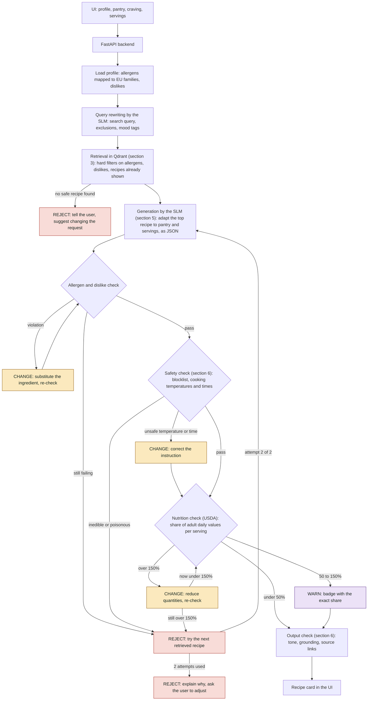
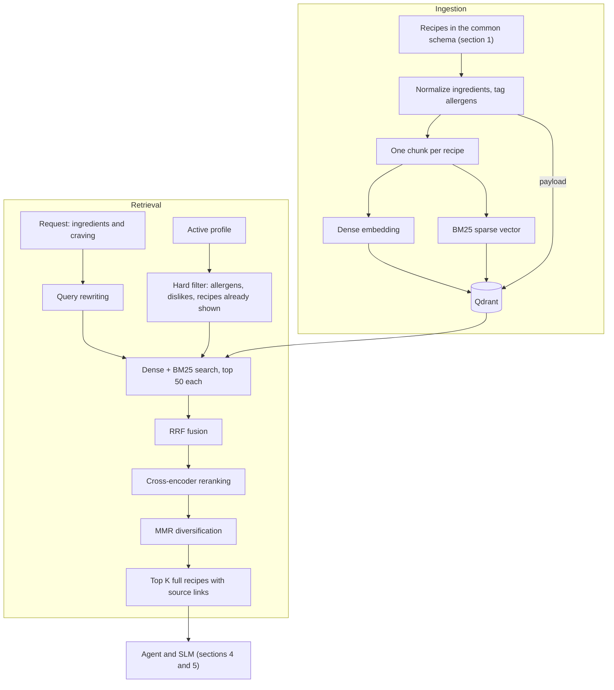
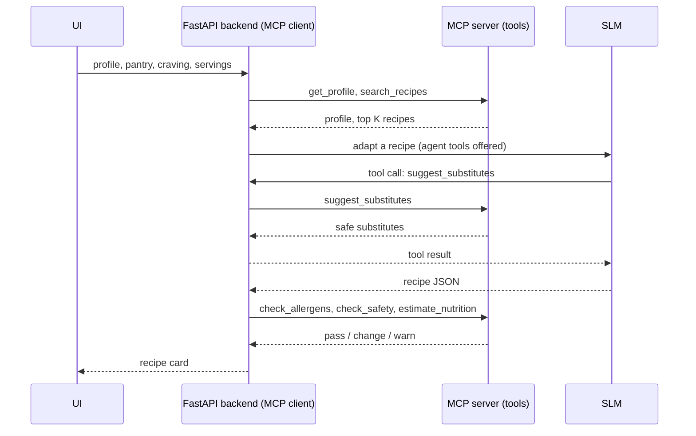

# Nibble – Milestone 2: Architecture and Plan

| Team member             | Sections                          |
| ----------------------- | --------------------------------- |
| Roșu Ioan-Luca          | 0. Overview, 4. Agent and tools, 7. Plan |
| Chelariu Răzvan-Dumitru | 1. Problem and data               |
| Crețu Vlad-Cristian     | 2. Golden dataset                 |
| Fazacaș Mihai-Tudor     | 3. RAG design                     |
| Ciocîia Marius Andrei   | 5. Model choices, 6. Safety       |

<!-- RULES: edit ONLY between your own BEGIN/END markers. Do not reformat the rest of the file. One PR per person, targeting main. -->

## 0. Architecture overview
<!-- BEGIN 0 (Luca) -->

Nibble's request pipeline has fixed steps that always run, plus optional tools the agent may call (section 4). Retrieval happens **once, before generation**, and every recipe passes three checks **after generation** and before it reaches the screen. Each check can **reject**, **change** or **warn**, as marked below.



### Where a recipe can be rejected, changed or warned about

| Check | When it runs | Reject | Change | Warn |
| --- | --- | --- | --- | --- |
| Retrieval filters (section 3) | Before generation | No recipe matches the hard filters | – | – |
| Allergen and dislike check | After generation | Still failing after a substitution | Substitute the ingredient | – |
| Inedible or poisonous ingredients (section 6) | After the allergen check | Always, then the next recipe is tried | – | – |
| Cooking temperatures and times (section 6) | After the allergen check | – | Correct the instruction (e.g. poultry to 75 °C) | – |
| Nutrition (USDA, per serving) | Last, before output | Still over 150% after reducing quantities | Reduce quantities when over 150% | 50–150% of a daily value |
| Output check (section 6) | Before display | – | Rewrite unsupported or rude text | – |

A rejected recipe is replaced by the next retrieved one, up to **2 attempts**. After that, Nibble tells the user why and asks them to adjust the request. The allergen filter in retrieval lowers the risk, but the check after generation is still required, because the model can add an ingredient by itself.

### Walkthrough of one request

Request: *"I'm lactose intolerant, hate mushrooms, and have chicken, rice and spinach; make me dinner."* 2 servings.

1. **Profile:** "lactose" maps to the `milk` allergen family; "mushrooms" is a dislike.
2. **Query rewriting:** `{"query": "chicken rice spinach dinner", "exclude": ["mushrooms"], "tags": []}`.
3. **Retrieval:** Qdrant searches the recipe pool (section 1) with `must_not` on `milk` and `mushrooms`, keeping only recipes with verified allergen tags, and returns the top 5.
4. **Generation:** the SLM adapts the best match, a one-pot lemon garlic chicken with rice, to 2 servings. The pantry is a soft constraint: the recipe uses all 3 pantry items and lists the rest (lemon, garlic, onion) as "you'll need".
5. **Allergen check:** the model added butter, so it is **changed** to olive oil, and the re-check passes.
6. **Safety check:** the chicken step had no target temperature, so it is **changed** to "until it reaches 75 °C inside".
7. **Nutrition check:** salt is 71% of the daily value per serving, so the card shows a **warning**.
8. **Output:** the recipe card with the warning badge and source links.

### Swaps, refinements and rerolls

| Action | Where it re-enters the pipeline |
| --- | --- |
| Swap one ingredient | The SLM rescales the recipe, then all checks run again from the allergen check |
| Refinement ("make it spicier") | Generation, with the current recipe as context, then all checks |
| Reroll | Retrieval, with the recipes already shown excluded |

Strict pantry mode ("only use what I have") is available as an option. It matches the compliance gate used in evaluation (section 2).

<!-- END 0 -->

## 1. Problem and data
<!-- BEGIN 1 (Răzvan) -->
<!-- What task does the system handle? Which datasets (RecipeNLG, web recipes, USDA, Open Food Facts) and why? How are NEW datasets ingested (common recipe schema, accepted formats, pipeline steps)? -->

**Task.** Nibble generates a complete, structured recipe (title, servings, ingredient lines with amounts, steps) from the ingredients the user has plus a preference ("mood") such as high-protein, keto, vegan or spicy. The data work below produces (a) a recipe pool with nutrition information, (b) fine-tuning data for the SLM and (c) the golden test set (section 2).

**Datasets used and why**

| Dataset | Size | What it gives us | Why |
|---|---|---|---|
| Kaggle `recipes-dataset-64k-dishes` | 62,126 raw rows | title, category, ingredient lines, step lists | Large recipe text source. No nutrition and no servings. |
| Hugging Face `xiaoxl/recipe_data` (labelled MIT) | 107,064 rows; 24,367 have servings and calories/protein/carbs/fat | recipes with per-serving nutrition | The only source we found with full recipe text and per-serving macros. Rows with nutrition link to allrecipes.com. |
| USDA FoodData Central, SR Legacy (public domain) | 7,793 foods | per-100 g macros and household-measure gram weights | Lets us compute macros from any ingredient list and check the labels. |

Looked at and not used: RecipeNLG (about 2.2M recipes, but no nutrition and a non-commercial research licence) and MM-Food-100K (food photos with no steps, quantity-less ingredient lists, macros estimated from photos, non-commercial licence). Open Food Facts, FlavorDB and food2vec from the RFC are not used in the dataset work so far.

**How a new dataset is ingested.** Every source is converted to one common schema and goes through the same steps. The steps are scripts in `scripts/` and cells in `recipes.ipynb`. A new source needs a small adapter that maps its columns to the schema (CSV, JSON and Parquet have been read so far); there is no generic upload tool yet.

Common schema: `recipe_title`, `category`, `subcategory`, `description`, `ingredients` (list of lines with amounts), `directions` (list of steps), optional `servings` and per-serving `kcal`, `protein_g`, `carb_g`, `fat_g`, `fiber_g`, `sodium_mg`. The pipeline adds `recipe_id`, `source`, `nutrition_basis` and `single_step`.

1. **Acquire.** Kaggle through `kagglehub`; Hugging Face Parquet shards downloaded one at a time, text and nutrition columns kept, shard deleted (`scripts/pull_xiaoxl.py`); USDA SR Legacy as a CSV zip.
2. **Parse** ingredient and direction text into lists.
3. **Clean.** Drop recipes with fewer than 4 ingredients (many are truncated lists such as only `cooking spray`), under 60 characters of directions, or non-food categories (pet food, DIY). Single-step recipes are flagged, not dropped. Later (step 5) recipes with more than 4,000 kcal in total are also dropped, because big-batch recipes do not suit a home-cooking app.
4. **Deduplicate.** Key = normalized title + sorted normalized ingredients. About 60% of Kaggle rows were the same recipe listed under several categories, so one row is kept (most specific category) and all categories are stored. A new source is also checked against the existing pool (title, directions or ingredient match) so no recipe enters twice.
5. **Nutrition check.** Macros are recomputed from the ingredient lines with USDA data (`recipe_eval/nutrition.py`: hand-written overrides, then cached ingredient-to-USDA matches, then word overlap). A source label is kept only if the recomputed values agree: calories within 25%, other macros within 40%, at least 80% of ingredients matched. Recipes without servings keep computed whole-recipe totals (so calorie shares). Recipes with a total above 4,000 kcal are dropped (4,859 recipes), and for the Kaggle recipes that remain, `servings` is set to `round(total / 750 kcal)` (1 to 5) so a serving is about 750 kcal, flagged `servings_estimated`. This is a normalising choice, not a recovered fact.
6. **Merge and label.** One file, `data/recipes_merged.jsonl`. Tags are derived by rule (section 2). Training and test files are built from it (`scripts/build_train.py`, `scripts/build_examples.py`).

**Resulting pool** (`data/recipes_merged.jsonl`, 23,395 recipes)

| Source | Nutrition | Recipes |
|---|---|---|
| Kaggle | computed from ingredients, whole-recipe totals; servings estimated at about 750 kcal each | 15,251 |
| Kaggle | none (under 80% of ingredients matched), no servings | 4,798 |
| xiaoxl | per-serving label, agrees with the USDA recomputation | 3,346 |

A record has the common schema plus `calc_kcal_total`, `calc_protein_total`, `calc_carb_total`, `calc_fat_total` and `calc_coverage` (computed totals and the share of ingredients matched) and `servings_estimated`. No recipe in the pool is above 4,000 kcal in total. Computed macros are about 15% off at the median against labels, so they are estimates, not ground truth.

**How the data is used.** The pool feeds (1) the golden test set (section 2), (2) fine-tuning data for the SLM (section 5): 19,692 training and 1,036 validation examples, built from recipes that are not in the test set, and (3) the nutrition calculator, which is also used by the scorer and could be reused by the agent's nutrition tool (section 4). Check the licences before training or releasing a model: the recipe text comes from recipe sites.

<!-- END 1 -->

## 2. Golden dataset
<!-- BEGIN 2 (Vlad) -->
<!-- How are representative test cases and expected answers created? Size, format, categories (normal, edge, adversarial), how expected answers are checked (constraints, not exact text), who reviews them. Which metrics run on it? -->

**Purpose.** A test set for the recipe generator: given ingredients and a mood, does the model return a usable recipe built around the user's ingredients that fits the mood? Expected answers are constraints, not exact text.

**How test cases are created** (`scripts/build_examples.py`). Each case is built from one recipe in the pool:
- **Request:** the recipe's ingredient names (staples removed) plus 0-2 random *distractor* ingredients taken from other recipes, shuffled, plus 1-2 mood tags the recipe really has.
- **Reference answer:** the source recipe (title, servings, ingredients, steps) and its nutrition: per serving for xiaoxl rows, whole-recipe computed totals (with servings estimated at about 750 kcal each) for Kaggle rows.
- **Tags** are derived by rule (`recipe_eval/labels.py`, thresholds in one place). Macro tags use shares of calories: `high_protein` (protein at least 25%), `high_carb` (carbs at least 55%), `low_carb` (carbs at most 20%), `keto` (carbs at most 10% and fat at least 60%). Computed shares must clear a threshold by 3 points. `low_calorie` (at most 400 kcal per serving) needs real servings, so it exists only for xiaoxl rows. Keyword tags are read from the ingredient list: `vegetarian`, `vegan`, `dairy_free`, `gluten_free`, `spicy` (approximate).

**Size and format.** 1,200 cases, 120 per tag, JSON Lines in `data/eval_examples.jsonl`. Fields: `example_id`, `recipe_id` (link to the pool), `source`, `nutrition_basis`, `request` (`ingredients`, `tags`), `distractors`, `golden`. 768 cases come from Kaggle recipes and 432 from xiaoxl; 753 request two tags; 818 contain distractors.

**Categories**

| Category | What is in the set |
|---|---|
| Normal | Ingredients of a real recipe plus 1-2 matching mood tags (all 1,200 cases) |
| Edge | Distractor ingredients the model should not be forced to use (818); single-step recipes (flagged in the pool); cases whose nutrition is computed rather than labelled (768 cases) |
| Adversarial | **Not built yet.** Planned: allergen conflicts, inedible or unsafe ingredient combinations, contradictory moods, requests that cannot be satisfied from the given ingredients |

**How answers are checked.** Not by matching the reference text. `recipe_eval/scoring.py: score_response(request, response)` returns three scores in [0, 1]:
1. **Compliance (hard gate).** The recipe must use at least one of the user's ingredients (salt, pepper, water and cooking oil are always allowed and do not count). Extra ingredients that are not on the user's list are allowed and reported (`extras`, `pantry_share`); an optional `EXTRA_PENALTY` can make them cost points. A recipe that uses none of the user's ingredients scores 0.
2. **Preference.** How well the answer fits each requested tag. Keyword tags are pass/fail. Macro tags compute the answer's own nutrition from its ingredient lines (USDA) and score calorie shares with a 15% tolerance band, because the calculator is about 15% off at the median. Calorie shares do not depend on servings, so the model cannot game this score by claiming a different serving count.
3. **Feasibility.** Rule checks: at least 2 steps, ingredients used in the steps, sane temperatures (100-600 F / 40-320 C) and times, an oven temperature when baking, amounts given. Optionally blended 50/50 with a 1-5 LLM-judge rating.

`overall = 0.3 x compliance + 0.4 x preference + 0.3 x feasibility`.

**Metrics reported.** Mean overall score; mean of each sub-score; compliance-failure rate (share of answers that use none of the user's ingredients) and the average share of extra ingredients; all broken down by tag and by nutrition source (labelled vs computed). Sanity checks done: the reference recipes scored as if they were model answers average 0.992 (minimum 0.93); an answer with none of the user's ingredients scores 0, and extras alone do not fail it.

**Who reviews.** Right now verification is automatic only (label-versus-USDA agreement and the sanity checks above); no person has reviewed the cases yet. Proposed: a hand review of 50-100 sampled cases by the evaluation owner and a second team member, recorded in a `reviewed_by` field.

**Link to fine-tuning.** Training and validation files use the same prompt and answer format (`recipe_eval/prompt.py`) and exclude every test recipe, so a fine-tuned model can be scored with no conversion.

**Known limits.** No adversarial cases and no human review yet. User allergen and dislike profiles, such as the RFC example "lactose intolerant, hates mushrooms", are only partly covered (`dairy_free`, `gluten_free`; dislikes are not modelled). Nutrition is approximate (about 15% at the median), 4,798 pool recipes have none, and Kaggle servings are estimated (about 750 kcal each), not recorded. Feasibility rules catch obvious nonsense, not subtle cooking errors.

<!-- END 2 -->

## 3. RAG design
<!-- BEGIN 3 (Mihai) -->
<!-- Chunking strategy, embedding model, vector database, metadata filtering, RAG approaches to compare (e.g. dense vs hybrid, reranking, query rewriting). Explain WHY for each choice. -->

RAG gives the SLM real recipes to adapt, so that quantities, step order and cited sources come from retrieved text instead of the model's memory. The main design constraint is that **a profile's allergens must never reach the model through retrieval**, so filtering is part of the retrieval design rather than a later cleanup step.

Only recipes go into the vector database. USDA nutrition data and Open Food Facts allergen data need exact lookups, where a semantically close but wrong food would be a bug, so the agent reaches them as structured tools (section 4).



The diagram shows every candidate stage. Hybrid search, query rewriting and reranking stay in the final system only if they win the experiments in 3.4.

### 3.1 Chunking: one chunk per recipe

**Decision:** each recipe is one chunk, built from its structure, and retrieval always returns the full recipe.

| Why | Explanation |
| --- | --- |
| **Recipes depend on all their parts** | Steps use the quantities in the ingredient list. A fixed-size window can separate "200 g rice" from the step that cooks it, which invites the model to invent the missing part. This is the hallucination RAG is meant to reduce. |
| **Constraints apply to whole recipes** | "Contains milk" is a property of the recipe. With one chunk per recipe, a filter can't let through one safe-looking fragment of an unsafe recipe. |
| **Top K means K distinct recipes** | Several hits can't come from the same recipe, so the small SLM context isn't spent on duplicates. |

The text we index is built from a template:

```text
{title}
Ingredients: {ingredient names}
Directions: {directions}
```

- **Dense vector:** embeds the full template. It uses ingredient names without quantities, because "200 g" adds noise to a similarity search. Text past the model's 512-token limit is cut from the end of the directions, keeping the title and ingredients, which we expect to carry the most signal. We will measure how many recipes this affects before freezing the choice.
- **BM25 vector:** indexes only the title and ingredient names, so a pantry search for "chicken" matches recipes built on chicken, not ones that mention it in passing.
- **Payload:** stores the full ingredient lines and directions (for the model), plus `ingredients_norm[]`, `allergens[]`, `allergen_status`, `source` and `link` (for filters and citations).
- **New data:** web recipes go through the same schema, which removes page text such as blog stories before chunking. Point IDs are content hashes, so ingesting a new dataset is an idempotent upsert with no full reindex.

### 3.2 Embedding model: `BAAI/bge-small-en-v1.5`

**Decision:** start with `bge-small-en-v1.5`, then confirm it in experiment R2.

| Model | Dimensions | Max tokens | License | Role |
| --- | --- | --- | --- | --- |
| `all-MiniLM-L6-v2` | 384 | 256 | Apache 2.0 | Lightweight baseline |
| **`bge-small-en-v1.5`** | 384 | 512 | MIT | **Default** |
| `bge-base-en-v1.5` | 768 | 512 | MIT | Tests whether a larger model is worth the cost |

- **Fits one recipe:** the 512-token limit suits our recipe-sized chunks better than MiniLM's 256.
- **Runs locally:** queries are embedded on CPU next to the SLM, with no API cost and no profile data leaving the machine.
- **Small vectors:** the full RecipeNLG corpus (2,231,142 recipes) at 384 dimensions is about 3.4 GB of raw vectors, against about 6.9 GB at 768, before index overhead. A 100,000-recipe development sample needs about 150 MB.
- **Contextual:** a craving like "something comforting" is a phrase, not a word. food2vec gives static word-level vectors, so we keep it for the pairing score from the RFC and don't use it for retrieval.

The corpus and the first version of Nibble are English only.

### 3.3 Vector database: Qdrant

**Decision:** Qdrant, running as a server in Docker. Filtering is the deciding factor.

If a database finds the top K first and filters afterwards, a dairy-free search for "creamy pasta" can lose most of its results. Qdrant applies the filter during the graph search and adds filter-aware links to its HNSW index, so filtered searches keep returning enough results. It also runs dense search, BM25 and RRF fusion in one query, so experiment R3 needs no second search engine.

| Option | Filtering | Why not chosen |
| --- | --- | --- |
| **Qdrant** | Payload indexes used during HNSW search | Chosen |
| FAISS | Restricts search to a list of IDs | It is a library, so we would have to store metadata and compute those ID lists ourselves |
| pgvector | Filters after the index scan by default; iterative scans can still return fewer rows than requested | Needs tuning to get the behaviour we need by default |
| Chroma | Array filters such as `$not_contains` | Viable fallback, but it has no equivalent we could confirm for filter-aware HNSW and one-query hybrid search |

Payload indexes on `allergens` and `ingredients_norm` must be created **before** the bulk upload, because Qdrant only builds the filter-aware links for fields already indexed when the graph is built.

**How each constraint is applied:**

| Input | Rule | Type | Reason |
| --- | --- | --- | --- |
| Allergens | `must_not` on `allergens`, and `allergen_status` must be `verified` | Hard, never relaxed | Mapped to the 14 EU families, so "lactose" becomes `milk` |
| Dislikes and "no X" in a craving | `must_not` on `ingredients_norm` | Hard, relaxed only if too few results remain | A preference, not a safety risk; a relaxed result must have the ingredient swapped |
| Recipes already shown | `must_not` on ID | Hard | Reroll must return a different recipe |
| Available ingredients, likes | Added to the query text | Soft | Requiring every ingredient would empty the results, and users may want to use only some of them |
| Meal type, mood | Added to the query text | Soft | RecipeNLG has no reliable labels for these |

**A missing tag looks exactly like a safe recipe.** That is why `allergen_status` exists: a recipe is `verified` only if every normalized ingredient mapped to the allergen taxonomy, using the longest match so "peanut butter" and "coconut milk" don't resolve to plain "butter" and "milk". When a profile has allergens, unverified recipes are excluded. This costs some recall, which we accept and measure. Retrieval only lowers the risk: the final recipe still has to pass the safety checks in section 6, since the model can add an allergen by itself.

### 3.4 RAG approaches to compare

**Baseline:** one chunk per recipe, `bge-small-en-v1.5`, dense search with the hard filters, raw request as the query, top 5.

We change one factor at a time and keep each winner, which avoids testing every combination. Index-changing experiments run first because they are the most expensive to redo.

| ID | Compare | Why it might matter for Nibble |
| --- | --- | --- |
| **R1** Chunking | One per recipe vs ingredient and step sections returning the parent recipe vs fixed 256 tokens with overlap (control) | Tests the choice in 3.1 instead of assuming it |
| **R2** Embedding | The three models in 3.2, with and without the BGE query prefix | Tests whether a larger model improves results enough to justify its size |
| **R3** Retriever | Dense vs BM25 vs hybrid with RRF | Ingredient names need exact matches and cravings need semantic ones. RRF combines the two by rank, so their scores don't need to be comparable |
| **R4** Query rewriting | Raw request vs structured rewrite vs HyDE | Cravings are vague and embeddings handle negation poorly, as in the example below |
| **R5** Reranking | None vs `bge-reranker-base` vs `ms-marco-MiniLM-L6-v2`, reordering the top 50 | Precision may improve, at a CPU latency cost we need to measure |
| **R6** Context size | K = 3 vs K = 5, and MMR on vs off | The SLM's context is small, and near-duplicate recipes make rerolls feel the same |

Structured rewriting has the SLM turn the craving into a query and explicit exclusions. For example, the craving "something comforting, no mushrooms, not too heavy" with chicken and rice available becomes:

```json
{"query": "comforting light chicken and rice dinner", "exclude": ["mushrooms"]}
```

`exclude` becomes a hard filter, because leaving "no mushrooms" in the text would pull the search *towards* mushrooms. HyDE instead embeds a short hypothetical recipe. Filters still apply to its search, so an allergen in the invented text can't let an unsafe recipe through. Both approaches add one SLM call, which counts towards their latency.

**How a winner is chosen,** using the golden dataset (section 2):

| Metric | Use |
| --- | --- |
| **Allergen leak rate** in retrieved recipes | Must be 0; any other result fails the configuration outright |
| **nDCG@5 and Precision@5** | Main quality metrics, labelled by pooling: we judge the union of each configuration's top 10, since we can't label millions of recipes |
| **Constraint pass rate** | Share of results matching the checkable parts of a request, such as available ingredients |
| **Reroll diversity** | Ingredient overlap (Jaccard) between consecutive rerolls, where lower is better |
| **p95 retrieval latency** | Target of 1 s, excluding SLM calls |

We adopt a more complex option only if nDCG@5 improves by at least 0.02, the paired bootstrap 95% interval excludes zero, and latency stays within target. Otherwise the simpler option stays. These thresholds are our proposed starting point and may change once the golden dataset's size is final.

**If time allows,** we will add a corrective RAG step to the agent loop: when the best reranked score falls below a threshold, the agent rewrites the query or searches the web instead of generating from weak context (section 4).

**What this section needs from the others:**

- **Section 1:** normalized ingredient names, allergen tags and the corpus subset to index.
- **Section 2:** test cases with pooled retrieval labels, in addition to the end-to-end checks.
- **Section 7:** time for experiments R1 to R6 in the timeline.

**References:** [RecipeNLG](https://github.com/Glorf/recipenlg), [BGE model card](https://huggingface.co/BAAI/bge-small-en-v1.5), [Qdrant indexing](https://qdrant.tech/documentation/manage-data/indexing/), [Qdrant hybrid search](https://qdrant.tech/documentation/search-tuning/hybrid-search/), [Faiss ID filtering](https://github.com/facebookresearch/faiss/wiki/Setting-search-parameters-for-one-query), [pgvector HNSW filtering](https://supabase.com/docs/guides/ai/vector-indexes/hnsw-indexes.md), [Chroma filters](https://docs.trychroma.com/reference/where-filter). HyDE and corrective RAG come from Lecture 5.

<!-- END 3 -->

## 4. Agent and tools
<!-- BEGIN 4 (Luca) -->
<!-- Which decisions the agent makes vs fixed pipeline steps, the list of tools (inputs/outputs), how they are exposed through the MCP server, agent framework. -->

The pipeline in section 0 is **code, not the model's choice**: the backend always runs retrieval and the three checks in a fixed order. The SLM acts as an agent only *inside* generation, where it may call optional tools. Small models are unreliable at deciding when to call a tool, so nothing safety-related depends on the model choosing to call it.

### What the code decides vs what the agent decides

| Fixed steps (always run, in this order) | Agent decisions (the SLM chooses) |
| --- | --- |
| Load the profile | Which of the top K retrieved recipes to adapt |
| Query rewriting (one SLM call with a fixed prompt) | Whether to substitute an ingredient the user lacks or dislikes |
| Filtered retrieval | Whether to look for a creative pairing |
| Allergen, safety and nutrition checks | How to apply a refinement ("make it spicier") |
| Retries: next recipe, at most 2 attempts | When the recipe is finished (at most 4 tool calls per generation) |
| Output check | Whether to search the web when retrieval is weak *(stretch goal)* |

### Tools

All tools live in one MCP server. "Pipeline" tools are called by the backend directly; "agent" tools are offered to the SLM.

| Tool | Input | Output | Called by | Backed by |
| --- | --- | --- | --- | --- |
| `get_profile` | `profile_id` | allergens (EU families), dislikes, likes | Pipeline | SQLite profile store |
| `search_recipes` | `query`, `exclude[]`, `profile_id`, `shown_ids[]`, `k` | top K full recipes with source links | Pipeline | Qdrant (section 3) |
| `check_allergens` | recipe JSON, `profile_id` | pass, or violations `[{ingredient, allergen}]` | Pipeline | Allergen taxonomy (section 6) |
| `check_safety` | recipe JSON | blocked ingredients, unsafe steps with a corrected instruction | Pipeline | Blocklist and temperature rules (section 6) |
| `estimate_nutrition` | recipe JSON, `servings` | per-serving kcal, fat, sugar, salt, % of daily values, `ok` / `warn` / `over` | Pipeline | `recipe_eval/nutrition.py`, USDA (section 1) |
| `suggest_substitutes` | `ingredient`, `profile_id`, recipe context | ranked substitutes that are safe for the profile | Agent, and the UI swap button | Substitution table + food2vec similarity |
| `score_pairing` | ingredient list | pairing score, creative pairs | Agent | FlavorDB + food2vec (RFC) |
| `web_search_recipes` | `query` | recipes in the common schema | Agent *(stretch, cuttable)* | Web search + section 1 adapter |

Inputs and outputs are typed with Pydantic, so each tool publishes a JSON schema and every result is validated before it is used.

### How the tools are exposed through MCP

- **Server:** a Python MCP server built with the official MCP Python SDK (`FastMCP`), one decorated function per tool.
- **Transport:** stdio during development and in notebooks; streamable HTTP when the backend and the server run as separate processes.
- **Client:** the FastAPI backend is the MCP client. It calls pipeline tools directly, and passes the agent tools' schemas to the SLM, which requests them through native tool calling (an OpenAI-compatible endpoint from the model server, section 5).
- **Testing:** each tool can be called on its own with MCP Inspector, so tools are tested independently of the model.



### Agent framework: a plain Python loop

The agent loop is about 100 lines of Python: send the messages and the tool schemas, run any requested tool, append the result, and repeat until the model returns recipe JSON or hits 4 tool calls. Invalid JSON gets one repair attempt; after that the recipe is rejected and the next one is tried (section 0).

| Option | Why not chosen for now |
| --- | --- |
| LangGraph | Its graph and state model suit long multi-agent flows. Ours is one short loop plus fixed checks, so it would add a dependency without new capability. We will reconsider it if the retry logic grows. |
| Letting the model orchestrate everything | Safety checks would depend on the model choosing to call them, which section 6 rules out. |

Tool-calling traces from this loop (request, tool calls, results, final recipe) are logged, so they can become training examples for fine-tuning (section 5).

<!-- END 4 -->

## 5. Model choices
<!-- BEGIN 5 (Marius) -->
<!-- SLMs considered and why (size, tool calling, license, hardware). Fine-tuning plan: method (LoRA), training data, task format, when it happens. -->

#### **Model Choices, License and Hardware**

| **Criteria** | **Qwen3.5-4B** | **IBM Granite 4.2-3B** | **Ministral 3-3B** |
|:---|:---:|:---:|:---:|
| Parameters | 4B | 3B | 3B |
| Tool calling | Native agentic/tool support | Native reasoning and tool calling | Function calling and structured outputs |
| License | Apache 2.0 | Apache 2.0 | Apache 2.0 |
| Main Consideration | Best starting candidate | Particularly interesting for agent orchestration | Compact edge deployment |
| Recommended hardware and deployment | GPU, 8–12 GB VRAM with more comfortable inference and small-context QLoRA experiments, *maybe more VRAM if we do LoRA tuning* | GPU, 8–12 GB VRAM with more comfortable inference and small-context QLoRA experiments, *maybe more VRAM if we do LoRA tuning* | CPU, 8–16 GB RAM with 4-bit quantization and slower inference **OR** GPU 6–8 VRAM with 4-bit inference |
| Hardware we will use | Server with an RTX 3070 Ti (8 GB VRAM) and a MacBook (16 GB) | Server with an RTX 3070 Ti (8 GB VRAM) and a MacBook (16 GB) | An 8 GB RAM laptop we can dedicate to long CPU tests |
|Model Link| *https://huggingface.co/Qwen/Qwen3.5-4B* | *https://huggingface.co/ibm-granite/granite-4.2-3b* | *https://huggingface.co/mistralai/Ministral-3-3B-Instruct-2512* OR *https://huggingface.co/mistralai/Ministral-3-3B-Reasoning-2512* |

---

#### **Fine tuning**

LoRA or QLoRA with Hugging Face's PEFT or TRL libraries:

- https://huggingface.co/docs/peft/index
- https://huggingface.co/docs/trl/sft_trainer

**Suggested initial configuration**

| **Parameter** | **Suggested starting value** |
|:---|:---:|
| Method | QLoRA |
| Quantization | 4-bit NF4 |
| LoRA rank (r) | 16 or 32 |
| LoRA alpha | 32 or 64 |
| LoRA dropout | 0.05 |
| Learning rate | 1e-4 to 2e-4 |
| Epochs | 1–3 initially |
| Optimizer | Paged AdamW |
| Gradient checkpointing | Enabled |
| Training objective | Causal language modelling / SFT |

---

#### **Training Data**

| **Dataset component** | **Contents** | **Purpose** |
|:---|:---|:---|
| Recipe corpus | Ingredients, quantities, preparation steps, servings, cooking times | Learn recipe structure and terminology |
| User instructions | Dietary profiles, available ingredients, preferences and dislikes | Learn personalization |
| Agentic trajectories | User request, tool selection, tool results and final answer | Learn tool calling |
| Safety examples | Allergens, toxic ingredients, unsafe cooking conditions and conflicting constraints | Learn when to reject or request verification |

**Starting data and split:** the 19,692 training and 1,036 validation examples already built in section 1 cover structured recipe generation. The 1,200 golden cases (section 2) are the held-out test set, and their recipes are excluded from training. Tool-calling, substitution and safety examples are added on top, built from the agent loop's logged traces (section 4).

**Suggested Distribution of training tasks**

| **Task** | **Training proportion** |
|:---|:---:|
| Structured recipe generation | 35% |
| Tool selection and calling | 25% |
| Ingredient substitutions | 15% |
| Dietary restrictions and conflicting preferences | 15% |
| Safety-related responses and refusals | 10% |

---

#### **Task format and training examples**

Conversational instruction-tuning data with structured JSON outputs and explicit tool calls.

Hugging Face TRL supports this type of training through its SFTTrainer, which supports conversational messages, tool-call records, tool responses and a separate tools column containing JSON schemas: 

- *https://github.com/huggingface/trl/blob/main/docs/source/dataset_formats.md*
- *https://huggingface.co/docs/trl/sft_trainer*

**Example of JSON task format:**

```json
{
  "recipe": {
    "title": "Lemon Garlic Chicken with Spinach Rice",
    "servings": 2,
    "preparation_time": 10,
    "cooking_time": 25,
    "ingredients": [
      {
        "name": "Chicken breast",
        "quantity": 300,
        "unit": "g"
      },
      {
        "name": "Rice",
        "quantity": 150,
        "unit": "g"
      },
      {
        "name": "Spinach",
        "quantity": 100,
        "unit": "g"
      }
    ],
    "steps": [
      {
        "step": 1,
        "instruction": "Cook the rice according to its instructions."
      },
      {
        "step": 2,
        "instruction": "Cook the chicken thoroughly."
      },
      {
        "step": 3,
        "instruction": "Add spinach, garlic and lemon."
      }
    ]
  }
}
```

---

#### **Summary and experimental plan**

| **Component** | **Choice** |
|:---|:---|
| Primary SLM | Qwen3.5-4B |
| Comparative SLM | Granite 4.2-3B |
| Additional baseline | Ministral 3-3B |
| Fine-tuning method | QLoRA |
| Fine-tuning framework | Hugging Face TRL + PEFT |
| Training objective | Supervised Fine-Tuning |
| Training data | Section 1 training files + synthetic conversations + logged MCP trajectories (section 4) |
| Data split | Section 1 train/validation files; section 2 golden set as the test set |
| Output format | Structured JSON |
| Tool format | Conversational messages with JSON-schema function calls |
| Retrieval | Separate RAG pipeline |
| Safety | Deterministic validation services |
| Evaluation | Golden dataset (section 2), including the planned adversarial safety cases |

<!-- END 5 -->

## 6. Safety: toxicity and hallucinations
<!-- BEGIN 6 (Marius) -->
<!-- Allergen checks, poisonous/inedible blocklist, cooking temperatures and times, nutrition thresholds (50% / 150%), output moderation, grounding. -->

The general principle is the following: SLM proposes; specialized services verify; application decides whether a recipe can be served to the user.

We will have 4 validation outcomes:
 - PASS: The recipe satisfies the relevant checks
 - WARN: The recipe is usable, but requires a visible warning
 - BLOCK: The recipe contains an identified safety violation
 - UNKNOWN: There is insufficient information to establish safety

These map onto the pipeline in section 0: PASS continues, WARN adds a badge, and BLOCK either **changes** the recipe (when a safe fix exists, such as a substitute or a corrected instruction) or **rejects** it so the next retrieved recipe is tried. For allergens, UNKNOWN is always treated as BLOCK, matching the `verified`-only retrieval filter in section 3.

#### Allergen checking
Allergen categories defined in Annex II of Regulation (EU) No 1169/2011 (https://eur-lex.europa.eu/eli/reg/2011/1169/eng)

|Allergen category|	Examples|
|:---------------:|:-------:|
|Cereals containing gluten|	Wheat, rye, barley, oats, spelt|
|Crustaceans|	Crab, lobster, prawns|
|Eggs|	Chicken eggs, egg products|
|Fish|	Salmon, tuna, cod|
|Peanuts|	Peanuts and peanut products|
|Soybeans|	Soybeans, soy flour, soy protein|
|Milk|	Milk, cheese, butter, whey|
|Nuts|	Almonds, hazelnuts, walnuts, cashews, pistachios, etc.|
|Celery|	Celery root, celery leaves|
|Mustard|	Mustard seeds, mustard preparations|
|Sesame|	Sesame seeds, sesame products|
|Sulphur dioxide and sulphites|	Preservatives above 10 mg/kg or 10 mg/L|
|Lupin|	Lupin flour, lupin products|
|Molluscs|	Mussels, oysters, squid, snails|

Example of potential allergen classification system:
```json
{
  "ingredient": "Whey protein",
  "canonical_id": "milk_whey",
  "allergens": [
    "milk"
  ],
  "derivatives": [
    "whey",
    "whey protein concentrate",
    "whey powder"
  ]
}
```

Example of potential user restriction system:
```json
{
  "profile": {
    "allergens": [
      "peanuts",
      "milk"
    ],
    "intolerances": [
      "lactose"
    ],
    "disliked_ingredients": [
      "mushrooms"
    ],
    "dietary_preferences": [
      "high_protein"
    ]
  }
}
```

We also watch for hidden allergens in compound ingredients:
- Soy sauce can contain soy and wheat.
- Pesto can contain milk, nuts and sometimes other allergens.
- Stock cubes can contain celery, milk or other declared allergens.
- Chocolate can contain milk, soy and nuts.
- Bread crumbs can contain wheat.

#### Poisonous or inedible ingredient blocklist

|Category|Examples|Behaviour|
|:-:|:--:|:--:|
|Prohibited ingredients|	Poisonous mushrooms, toxic plant species, clearly inedible substances	|Always BLOCK|
|Conditionally unsafe ingredients|	Raw kidney beans, improperly processed cassava, unsafe plant parts|	BLOCK unless validated preparation requirements are satisfied|
|Food-safety hazards|	Spoiled ingredients, unsafe storage, contaminated food|	BLOCK or UNKNOWN depending on the evidence|

Example of potential hazard database structure:
```json
{
  "ingredient": {
    "canonical_id": "red_kidney_beans",
    "scientific_name": "Phaseolus vulgaris",
    "common_names": [
      "red beans",
      "kidney beans"
    ],
    "hazard": {
      "toxin": "phytohaemagglutinin",
      "severity": "high",
      "status": "conditional"
    },
    "preparation_requirements": {
      "soaking_required": true,
      "boiling_required": true,
      "slow_cooker_only": false
    },
    "source": "verified_food_safety_reference"
  }
}
```

Sources: 
- WHO: Natural toxins in food
- FDA: Foodborne pathogens and natural toxins
- EFSA: Chemical hazards and food contaminants
- National food-safety authorities: Practical Preparation and storage requirements

Useful links:
- https://www.who.int/news-room/fact-sheets/detail/natural-toxins-in-food
- https://www.fda.gov/food/foodborne-pathogens/bad-bug-book-second-edition
- https://www.efsa.europa.eu/en/topics/topic/chemical-contaminants-food
  
**Recommendation**: Maintain a curated database rather than dynamically asking the SLM whether an ingredient is poisonous.


#### Cooking temperatures and times

The system should validate whether cooking instructions are sufficient to prepare food safely.

We should distinguish between:
- **Cooking time:** Estimated duration required to cook an ingredient.
- **Core temperature:** Actual temperature reached inside the food.
- **Holding time:** How long food must remain at a particular temperature to achieve the required safety treatment.

Example of temperature-time combinations from the UK Food Standards Agency (FSA):

| Core temperature | Required holding time |
|:----------------:|:---------------------:|
| 60°C | 45 minutes |
| 65°C | 10 minutes |
| 70°C | 2 minutes |
| 75°C | 30 seconds |
| 80°C | 6 seconds |

These are alternative temperature-time combinations, not interchangeable instant-temperature targets. The applicable rule must be selected according to the food category and preparation method.

We can also use category-specific recommendations from FoodSafety.gov:

| Food | Minimum internal temperature | Additional requirement |
|:----:|:----------------------------:|:---------------------:|
| Poultry | 74°C | — |
| Ground meat | 71°C | Depends on meat category |
| Fish | 63°C | — |
| Whole beef, pork, lamb and veal cuts | 63°C | 3-minute rest |
| Egg dishes | 71°C | — |
| Leftovers and casseroles | 74°C | — |

Sources:
- UK Food Standards Agency: Cooking your food (https://www.food.gov.uk/safety-hygiene/cooking-your-food)
- FoodSafety.gov: Safe Minimum Internal Temperatures (https://www.foodsafety.gov/food-safety-charts/safe-minimum-internal-temperatures)

**Recommendation**: Maintain a curated database of food-specific cooking requirements rather than letting the SLM invent cooking temperatures or assume that a cooking duration guarantees safety.

Example of potential cooking requirements database structure:

```json
{
  "food_category": "poultry",
  "temperature_rules": [
    {
      "temperature_c": 70,
      "holding_time_seconds": 120,
      "source": "FSA"
    },
    {
      "temperature_c": 75,
      "holding_time_seconds": 30,
      "source": "FSA"
    },
    {
      "temperature_c": 80,
      "holding_time_seconds": 6,
      "source": "FSA"
    }
  ],
  "measurement": "internal_core_temperature",
  "required": true
}
```

We should also include food handling, storage and reheating:
- Leaving perishable food at room temperature for too long.
- Improperly cooling cooked food.
- Reheating food inadequately.
- Incorrectly thawing frozen meat.
- Storing cooked rice under unsuitable conditions (risk of *Bacillus cereus* growth).

**Validation outcomes:**
- PASS: Valid temperature-time combination.
- WARN: Estimated cooking duration without a verifiable endpoint.
- BLOCK: Explicitly insufficient cooking conditions, until corrected.
- UNKNOWN: Insufficient information about the ingredient or its storage history.


#### Nutrition thresholds (50% / 150%)

Calculate the nutritional composition per serving and compare it against adult reference intakes.

We should use the adult Reference Intakes defined in Annex XIII of Regulation (EU) No 1169/2011 as the primary nutritional baseline.

| Nutrient | Adult reference intake |
|:--------:|:----------------------:|
| Energy | 2,000 kcal |
| Total fat | 70 g |
| Saturated fat | 20 g |
| Carbohydrates | 260 g |
| Sugars | 90 g |
| Protein | 50 g |
| Salt | 6 g |

Source: Regulation (EU) No 1169/2011 (https://eur-lex.europa.eu/eli/reg/2011/1169/eng)

For caffeine, there is no equivalent EU food-labelling reference intake. Instead, use EFSA's daily intake guidance:
- Healthy adults: up to 400 mg/day.
- Pregnant women: up to 200 mg/day.
- Children and adolescents: 3 mg/kg body weight/day as a level of no safety concern.

For sugar, distinguish between total sugars (EU reference intake of 90 g) and free sugars (WHO recommendation of less than 10% of daily energy intake, ideally less than 5%). For a 2,000 kcal diet, these correspond to approximately 50 g and 25 g, respectively.

Sources:
- EFSA: Caffeine (https://www.efsa.europa.eu/en/topics/topic/caffeine)
- WHO: Healthy diet (https://www.who.int/news-room/fact-sheets/detail/healthy-diet)

**Proposed threshold system:**

| Percentage of reference intake | Status | Application behaviour |
|:------------------------------:|:------:|:---------------------:|
| Below 50% | Normal | Display nutritional information |
| 50–100% | Warning | Highlight significant contribution |
| 100–150% | High contribution | Display a more prominent warning |
| Above 150% | Very high contribution | Nibble changes the recipe: reduce quantities, substitute, or switch recipe (section 0) |

Example warning: *One serving provides 123% of the EU adult reference intake for sugars.*

Calculation formula:

$$
\text{RI percentage} = \frac{\text{Nutrient per serving}}{\text{Adult reference intake}} \times 100
$$

Example: If one serving contains 86 g of sugars:

$$
\frac{86}{90} \times 100 \approx 95.6\%
$$

The system should calculate nutritional values using a dedicated nutrition service rather than relying on SLM estimations.

The service should:
- Retrieve nutritional values for each ingredient.
- Normalize quantities and measurement units.
- Calculate the complete recipe's nutritional composition.
- Divide the totals by the number of servings.
- Recalculate everything after ingredient substitutions.

**Important:** Exceeding 150% of an adult reference intake does not mean a recipe is unsafe, so it is never a safety BLOCK. It is a very high nutritional contribution, so Nibble first reduces quantities or substitutes ingredients; if a value is still above 150%, the next retrieved recipe is tried (section 0).

Potential nutritional data sources:
- USDA FoodData Central (https://fdc.nal.usda.gov/)
- EFSA Food Composition (https://www.efsa.europa.eu/en/data-report/food-composition)
- Manufacturer nutritional declarations for packaged ingredients.

**Recommendation**: Use a dedicated nutrition database and calculation service. Nutritional values should be presented as estimates, since ingredient brands, serving sizes and cooking-related nutrient losses can introduce uncertainty.


#### Output moderation

Output moderation examines whether user requests, generated recipes and agent actions are safe and consistent with Nibble's intended functionality.

It has three components:

| Component | Responsibility |
|:---------:|:--------------|
| Input moderation | Identify harmful requests and dangerous intentions |
| Generated-output moderation | Validate generated recipes and responses |
| Agent and tool-use moderation | Prevent unauthorized or unsafe MCP tool execution |

**Input moderation examples:**

| User request | Expected behaviour |
|:------------|:------------------:|
| Make a lactose-free chicken recipe | ALLOW |
| Suggest a substitute for peanuts | ALLOW |
| How do I prepare raw kidney beans safely? | ALLOW with verified instructions |
| How can I make a poisonous mushroom edible? | BLOCK unsafe premise |
| How can I hide an allergen in someone's food? | BLOCK |
| Create an extremely restrictive starvation diet | BLOCK harmful instructions and redirect |

**Generated-output moderation** should inspect:
- Schema validity: Missing fields, incorrect types and malformed JSON.
- Dietary consistency: Conflicts with user preferences and restrictions.
- Allergen consistency: Prohibited allergens in generated ingredients.
- Food-safety consistency: Unsafe preparation and storage instructions.
- Nutritional consistency: Implausible values and incorrect calculations.
- Grounding consistency: Unsupported claims and fabricated citations.
- Content moderation: Dangerous instructions, misleading health claims and inappropriate responses.

**Agent and MCP moderation** should include:
- An explicit allowlist of MCP tools.
- JSON Schema validation for tool arguments.
- Restricted tool permissions.
- Maximum tool-call counts and execution timeouts.
- Validation of tool results before returning them to the model.
- No ability for the model to modify safety databases or validation thresholds.
- No ability for retrieved webpages to override system instructions.

We should also protect against prompt injection. Retrieved webpages must be treated as untrusted data, never as instructions to the agent.

Potential moderation models:
- Llama Guard (Meta).
- ShieldGemma (Google).
- Granite Guardian (IBM).

**Recommendation**: Combine rule-based validation with a dedicated moderation model where appropriate. Moderation models should classify potentially harmful requests and responses, but must not replace deterministic food-safety checks.

Useful reference: OWASP Top 10 for LLM Applications (https://genai.owasp.org/llm-top-10/).


#### Grounding

Grounding ensures that generated recipes and factual claims are supported by identifiable and reliable sources.

We should distinguish three types of grounding:

- **Recipe grounding:** Generated recipes should have identifiable real recipes as their basis.
- **Factual grounding:** Claims about ingredients, cooking methods and nutritional properties should have supporting evidence.
- **Safety grounding:** Safety-related claims should rely on authoritative food-safety sources, not arbitrary recipe websites.

**Recommended source hierarchy:**

| Information | Preferred sources |
|:-----------|:-----------------|
| Original recipes | Established recipe websites and licensed recipe datasets |
| Ingredient composition | USDA FoodData Central, EFSA and manufacturer data |
| Allergen classifications | EU Regulation 1169/2011, EFSA and product labels |
| Poisonous ingredients | WHO, FDA, EFSA and national food-safety authorities |
| Cooking temperatures | FSA, FoodSafety.gov and applicable national authorities |
| Nutrition thresholds | EU legislation, WHO and EFSA |
| Food-handling instructions | National food-safety authorities |


<!-- END 6 -->

## 7. Plan
<!-- BEGIN 7 (Luca) -->
<!-- Week-by-week timeline from week 6 to week 14, per member, including the experiments planned. This is a commitment, reviewed in week 12 via commit history. -->

The plan runs from week 7 (Nov 9) to the final presentation in week 14 (Jan 11–17). Core features are built in weeks 7–12, before the winter break. The break is used only for unattended model training, and weeks 13–14 (presession) are for evaluation, documentation and the presentation. Every member opens at least one PR in every working week.

### Milestones

| Week | Milestone | What we show |
| --- | --- | --- |
| 8–9 | Progress check | Notebook demo of the full pipeline from section 0: retrieval with hard filters, generation, and the points where a recipe is rejected, changed or warned about |
| 12 | GitHub review | All core features merged: UI wired to the backend, MCP tools, filtered RAG, safety checks, evaluation report v1, pilot fine-tuning run |
| 14 | Final presentation | Live demo with the fine-tuned SLM, documentation, base vs fine-tuned comparison |

### Week by week

| Week | Luca | Răzvan | Mihai | Marius | Vlad |
| --- | --- | --- | --- | --- | --- |
| **7** (Nov 9–15) | Repo structure, HTML UI prototype committed, base SLM served locally, MCP server skeleton with `get_profile` | Ingredient normalization (`ingredients_norm[]`) on the pool; large data files moved to Git LFS or a download script | Qdrant in Docker, payload indexes, baseline dense index of the 23,395-recipe pool | Allergen taxonomy (14 EU families, derivatives, compound ingredients) and poisonous blocklist | Golden set v2: allergen and dislike profiles and free-text cravings added to cases |
| **8** (Nov 16–22) | Agent loop v1 in a notebook: request → query rewriting → `search_recipes` → recipe JSON | Allergen tags and `allergen_status` on the pool, using Marius's taxonomy; re-index with Mihai | Hard filters and the `search_recipes` MCP tool; baseline retrieval metrics | `check_allergens` and `check_safety` tools (reject and change) | Adversarial cases; allergen leak rate added to the evaluation |
| **9** (Nov 23–29) | FastAPI backend serving the UI and its endpoints; `estimate_nutrition` tool (reuses `recipe_eval/nutrition.py`) | HTML prototype wired to the backend: profiles, request form, recipe card | Experiments R1 (chunking) and R3 (dense vs BM25 vs hybrid) | Nutrition thresholds, cooking temperature rules, output moderation | First baseline run of the base SLM on the golden set |
| **10** (Nov 30–Dec 6) | `suggest_substitutes` tool; tool-calling training examples from logged traces | Web recipe scraper into the common schema (new-data ingestion) | Experiment R4 (query rewriting); choose the winning setup | PR reviews | Pooled retrieval labels with Mihai; nDCG@5 and Precision@5 |
| **11** (Dec 7–13) | QLoRA training script (TRL + PEFT); swap, refine and reroll in the backend | UI: swaps, refinement chips, reroll, warning badges | Final retrieval setup; FlavorDB and food2vec data loaded for pairing | PR reviews | Full evaluation of the base SLMs (Qwen3.5-4B vs Granite 4.2-3B) |
| **12** (Dec 14–20) | Pilot QLoRA run with Marius; integration fixes | Saved recipes with versions (SQLite) *(cuttable)* | `score_pairing` tool; latency measurements | Pilot QLoRA run; safety evaluation on the adversarial cases | Creativity metric; evaluation report v1; everything merged before the review |
| **Break** (Dec 21–Jan 3) | Full QLoRA training on the RTX 3070 Ti server, unattended; start and check only | – | – | – | – |
| **13** (Jan 4–10) | Integrate the fine-tuned model | Data documentation | RAG documentation | Safety and fine-tuning documentation | Base vs fine-tuned comparison |
| **14** (Jan 11–17) | Demo rehearsal and final presentation | Same | Same | Same | Same |

### Experiments

| Experiment | Owner | Week |
| --- | --- | --- |
| R1 chunking, R3 retriever type | Mihai | 9 |
| R4 query rewriting | Mihai | 10 |
| R2 embedding model, R5 reranking, R6 context size | Mihai | Only if time allows *(cuttable)* |
| Base SLM comparison on the golden set | Vlad, Luca | 11 |
| Pilot QLoRA run | Luca, Marius | 12 |
| Full QLoRA training | Luca | Break |
| Base vs fine-tuned SLM | Vlad | 13 |

### If we fall behind

These are cut first, in this order: R2, R5 and R6; saved recipes with versions; `web_search_recipes` and corrective RAG; the creativity metric. The core pipeline, safety checks, evaluation and fine-tuning are never cut.

### Plan changes

Changes to this plan are recorded here through PRs, with the reason for each change.

| Date | Change | Reason |
| --- | --- | --- |
| – | – | – |

<!-- END 7 -->