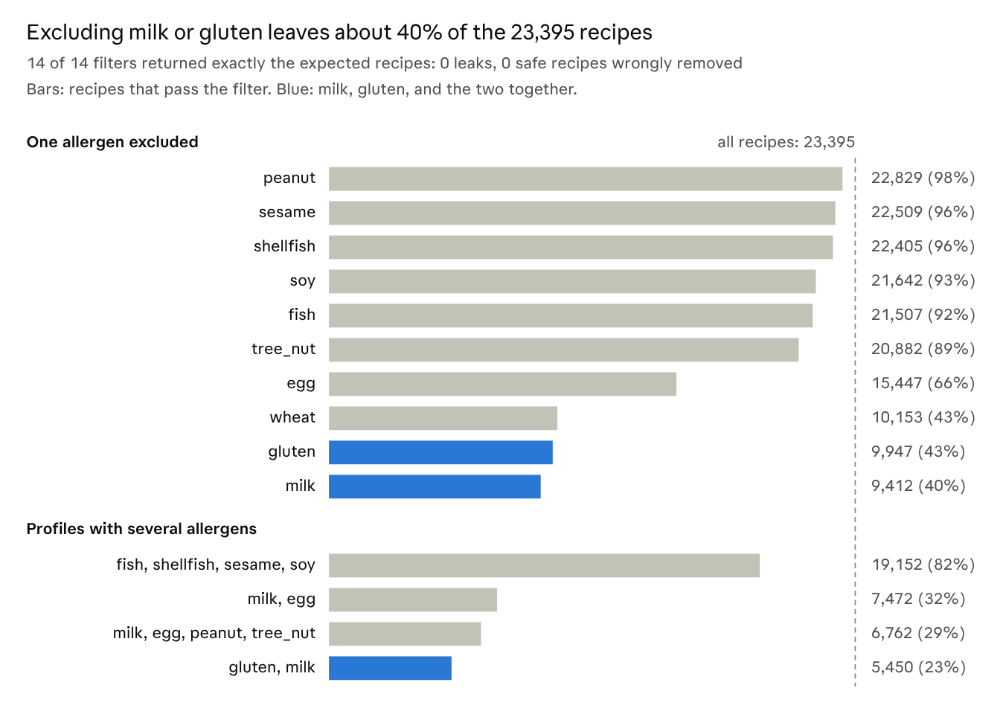

# Week 7 report: recipe index in Qdrant

15 Nov 2026 · Mihai · [living version (Claude Doc)](https://claude.ai/artifact/DmtBxFS5yQWsxmzfSwmx7M)

## Summary

The week 7 task is done: all 23,395 recipes of the pool are indexed in Qdrant (Docker, v1.20.0) with `bge-small-en-v1.5` vectors, and the allergen filter is exact on every recipe, with 0 leaks.

- **Index:** one point per recipe, a 384-dim dense vector, the full recipe as payload, and payload indexes created before the upload.
- **Allergen safety:** an exhaustive check over the whole index found 0 leaks and 0 safe recipes wrongly removed, for each of the 10 allergens and 4 multi-allergen profiles.
- **Chunking:** one chunk per recipe fits the model; only 0.9% of recipes go over its 512-token limit.
- **Not measured yet:** retrieval quality (nDCG@5, Precision@5) and latency on the server. Both are week 8 work.

## Setup

Qdrant runs as one Docker container; all other code is plain Python in the project's `.venv` and connects to it at the address in `config.yaml`.

| Part | Choice | Why |
| --- | --- | --- |
| Vector database | Qdrant `v1.20.0` in Docker (`docker-compose.yml`, container `nibble-qdrant`, ports 6333/6334) | Filtering inside the vector search; data kept in `qdrant_storage/` across restarts |
| Client | `qdrant-client` 1.20.0 | Same minor version as the server |
| Embedding model | `BAAI/bge-small-en-v1.5` through `fastembed` (ONNX, CPU) | 384 dims, 512-token limit, MIT; no PyTorch needed |
| Query text | BGE query prefix added to the request; recipes embedded without it | As recommended on the model card |
| Collection | `recipes`: dense vector `dense` (cosine), sparse slot `bm25` declared for later | BM25 can be added without rebuilding |
| Point ID | `uuid5` of `recipe_id` | Re-indexing overwrites, never duplicates |
| Payload indexes | `allergens`, `allergens_known`, `eval_holdout`, `tags`, `source`, `recipe_id` | The fields hard filters use; created before the bulk upload |

**Code** (`rag/`, run from the project root):

- `load.py`: reads the pool or the test set into one recipe shape, adds ingredient names, mood tags, allergens and the test-set flag, and builds the chunk text.
- `build_index.py`: creates the collection and indexes, embeds and uploads. Command: `python -m rag.build_index --source pool --recreate`.
- `search.py`: `search(query, k, exclude_allergens, exclude_recipe_ids, exclude_eval_set)`, the function the `search_recipes` MCP tool will call, plus the `--check` tests.
- `common.py`: shared settings, Qdrant client, model loading, point IDs.

## Data indexed

The index holds the whole pool, `data/recipes_merged.jsonl`: 23,395 recipes (20,049 Kaggle, 3,346 xiaoxl), each `recipe_id` unique.

- **Consistency with the test set:** all 1,200 golden `recipe_id`s are in the pool with matching titles, so IDs are stable. These 1,200 are marked `eval_holdout` and can be excluded from searches during evaluation.
- **Allergens:** computed from each recipe's own ingredients and steps with `recipe_eval/allergens.py`, then cross-checked against `data/recipe_allergens.json`: 23,395 of 23,395 agree. A disagreement stops the build before anything is uploaded.
- **Mood tags:** computed with the dataset's rules (`labels.py`); the counts match `DATASET_SUMMARY.md` exactly (vegetarian 14,043 down to keto 1,002).
- **Nutrition in the payload:** per-serving label values for the 3,346 xiaoxl recipes, computed totals for 15,251 Kaggle recipes, none for the rest.
- **Chunk text:** `{title}`, then `Ingredients:` with the ingredient names (amounts and staples removed), then `Directions:`.

**Chunk lengths** (bge tokenizer, all 23,395 chunks): median 180 tokens, 90th percentile 316, longest 1,268. 4,950 chunks (21.2%) exceed 256 tokens, the limit of the `all-MiniLM-L6-v2` alternative; 221 (0.9%) exceed bge's 512 and lose the end of their directions. Allergen filtering uses the payload, so truncation does not affect safety.

**Build speed:** about 9 recipes per second on the laptop CPU (Intel Core Ultra 7 155H), measured on the 1,200-recipe test after sorting chunks by length (4 per second without). The full-pool build embedded and uploaded all 23,395 recipes in 38 minutes, from 15:38 to 16:16 on 15 Nov (about 10 per second), after about 2 minutes of loading and allergen checks. Times are from Qdrant's request log: 366 upload batches of 64.

## Allergen filter results

The allergen filter is exact on the whole index: for every single allergen and every multi-allergen profile tested, the recipes that pass are exactly the recipes without it.

*Source: `python -m rag.search --check` on the full index, 15 Nov 2026.*

The exhaustive check first confirmed that the stored allergens of all 23,395 recipes equal those recomputed from each recipe's own text. Strict profiles still leave thousands of recipes: milk and gluten together keep 5,450.

The sample-query check agrees: in 20 queries chosen to attract an allergen, such as "creamy cheese pasta" for milk, the unfiltered top 20 contained it in 13 to 20 results, and the filtered top 20 in none. Run both with `python -m rag.search --check`.

## Robustness

Two of six robustness fixes are done, both about allergen safety; the other four are about operating the index and are planned for week 8.

| # | Weak point | Status | Fix |
| --- | --- | --- | --- |
| 1 | Allergens were looked up by `recipe_id` alone; a regenerated pool with shifted IDs and an old allergen file would silently swap allergens between recipes | Done | Computed from each recipe's own text; the file is only a cross-check, and a mismatch stops the build (tested with a tampered file) |
| 6 | The allergen test only sampled top-20 results of 20 queries | Done | Exhaustive check over every point with Qdrant's scroll (tested with a deliberately corrupted point: caught) |
| 2 | `--recreate` deletes the old index first, so search is down during the build and a crash leaves a half-full index | Open | Build into a new collection, verify, then switch an alias |
| 3 | The index does not record which model, chunk template and data built it | Open | Store a manifest; `search` refuses a model mismatch |
| 4 | Without `--recreate`, recipes removed from the pool stay searchable | Open | Solved by fix 2 |
| 5 | Updating allergens or tags means re-embedding everything (about 40 minutes) | Open | A payload-only refresh mode, needed when allergens are re-tagged in week 8 |

## Limitations and open questions

The filter is only as safe as the allergen labels, which come from a keyword matcher; the index stores and enforces them exactly, but cannot see hidden allergens.

- **Hidden ingredients:** the matcher cannot see allergens inside store-bought sauces, stock or additives. `check_allergens` after generation remains the second line of defence.
- **Allergen list mismatch:** the data has 10 allergens (`milk`, `egg`, `fish`, `shellfish`, `tree_nut`, `peanut`, `soy`, `sesame`, `wheat`, `gluten`); section 4 says profiles hold the 14 EU families. Celery, mustard, lupin and sulphites have no data, and molluscs are merged into `shellfish`. Today an unknown allergen makes search raise an error rather than ignore it.
- **No dislike filter yet:** it needs `ingredients_norm[]`, the week 7 ingredient normalization.
- **No source links:** the pool has no `url` column, so section 3's "top K full recipes with source links" cannot be met as written.
- **Section 3 is out of date:** it still describes RecipeNLG (rejected for its license) and an `allergen_status` field that the data replaced with `allergens` + `steps_only`.

Open questions:

- [ ] Which allergen list is final, 10 or 14, and who adds the missing four to the data?
- [ ] Should recipes whose allergens appear only in the steps (`steps_only`, 2,494 recipes) be treated differently?
- [ ] Is a source link required, and if so, can xiaoxl's `url` be added back to the pool?

## Next steps (week 8, Nov 16–22)

Week 8 turns the index into the `search_recipes` MCP tool and measures baseline retrieval quality.

- [ ] Wrap `rag.search.search()` as the `search_recipes` tool in the MCP server, once its skeleton is in place.
- [ ] Agree with the MCP and profile owners what `get_profile` returns, and the one allergen list everyone uses.
- [ ] Add the dislike filter on `ingredients_norm[]` when it lands in the pool.
- [ ] Baseline retrieval metrics on the golden set: nDCG@5, Precision@5, constraint pass rate, p95 latency on the Docker server.
- [ ] Robustness fixes 2, 3 and 5 (alias swap, index manifest, payload-only refresh) before the week 8 allergen re-tagging.
- [ ] Update section 3 of `MILESTONE2.md` with this report's numbers and the changes above.
